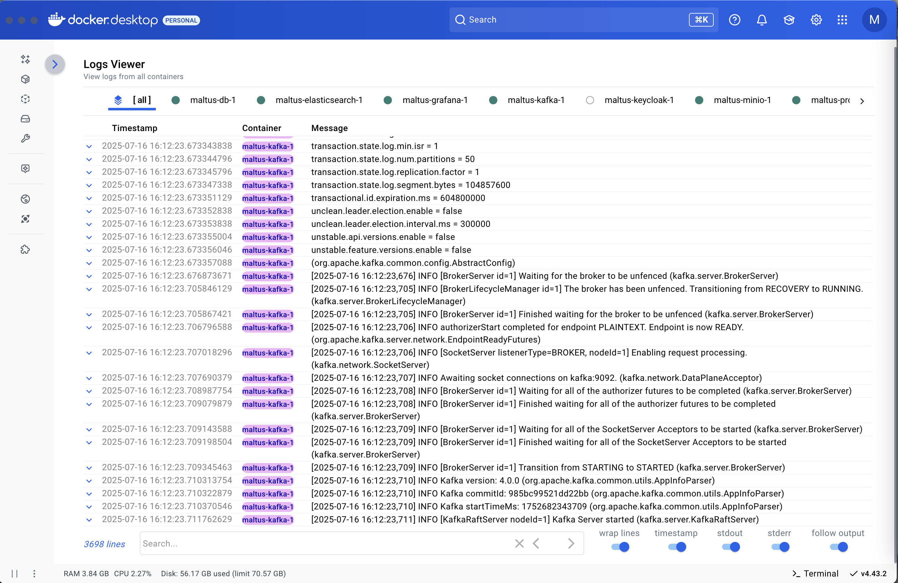

# Docker Container Logs Viewer

Docker extension for monitoring containers' logs with comfortable user-friendly UI/UX to troubleshoot faster. 

**Key features:**

- Collect logs in real-time
- Search logs with navigation
- Compact logs view: similar to CLI output  
- Isolated tabs per container
- Scrollable tabs horizontally
- All logs separated tab
- Show container status
- Optimized rendering for big amount of logs
- Own settings per container:
  - wrap/unwrap lines
  - show/hide sys timestamp
  - show/hide stdout
  - show/hide stderr
  - follow/unfollow output
- Expand/collapse row: render pretty formatted JSON log message

> Tech stack:
>
> - Frontend: Node, React, Typescript, Vite, MUI.
> - Backend: no backend.

**Screenshots**

